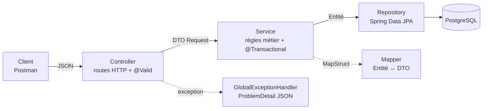
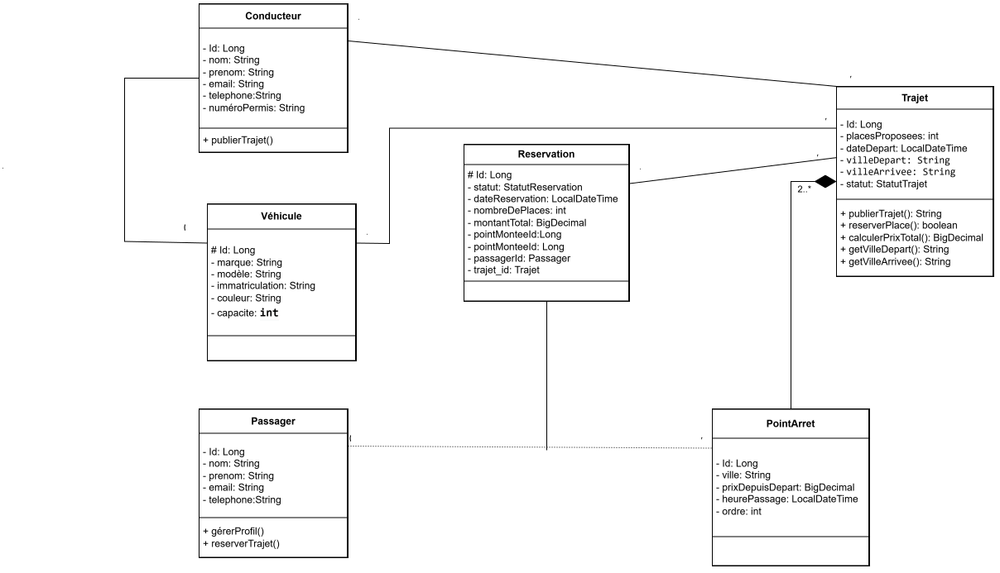
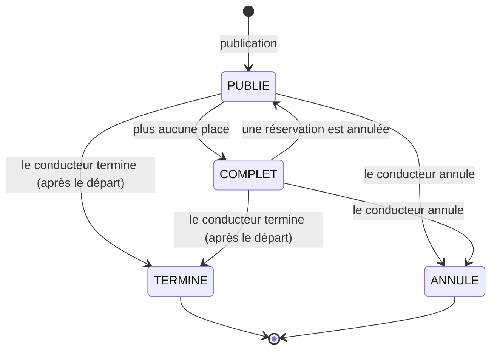

# 🚕 TAXI : API REST de covoiturage interurbain multi-étapes


API REST **Spring Boot** qui met en relation des **conducteurs** et des **passagers** autour de trajets interurbains avec arrêts intermédiaires.

Un passager ne réserve pas forcément tout le trajet. Il peut réserver **un segment** : monter à Settat et descendre à Marrakech sur un trajet Rabat → Casablanca → Settat → Marrakech. Le prix du segment est calculé automatiquement et les places restantes sont mises à jour dans la même transaction que la réservation.

---

## Sommaire

1. [Le problème résolu](#-le-problème-résolu)
2. [Fonctionnalités](#-fonctionnalités)
3. [Stack technique](#-stack-technique)
4. [Lancement rapide](#-lancement-rapide)
5. [Architecture](#-architecture)
6. [Modèle de données](#-modèle-de-données)
7. [Règles métier](#-règles-métier)
8. [Endpoints](#-endpoints)
9. [Exemple complet : de la publication à la réservation](#-exemple-complet--de-la-publication-à-la-réservation)
10. [Gestion des erreurs](#-gestion-des-erreurs)
11. [Tests](#-tests)
12. [Collection Postman et scénarios de validation](#-collection-postman-et-scénarios-de-validation)
13. [Choix techniques](#-choix-techniques)
14. [Organisation du projet](#-organisation-du-projet)

---

## Le problème résolu

Hamid part de Rabat pour Marrakech avec 3 places libres et passe par Casablanca et Settat. Sans cette API, il ne peut vendre que le trajet complet. Les voyageurs qui vont seulement de Settat à Marrakech ne le trouvent pas, et la voiture roule à moitié vide.

L'API permet :

- au **conducteur** de publier son trajet avec tous ses arrêts, l'heure de passage et le prix depuis le départ à chaque arrêt ;
- au **passager** de chercher *« Settat → Marrakech le 5 décembre »* et de trouver ce trajet, alors que ni Settat ni Marrakech n'en sont le point de départ ;
- de **payer le juste prix du segment** : 120 − 70 = 50 DH, et non 120 DH ;
- de **ne jamais vendre plus de places que le véhicule n'en a** : le trajet passe automatiquement à `COMPLET`.

---

##  Fonctionnalités

| Domaine | Ce que l'API permet |
|---|---|
| **Conducteurs** | Créer, consulter, modifier, rechercher par nom ou email, lister ses trajets |
| **Passagers** | Créer, consulter, modifier, rechercher par email, consulter l'historique de ses réservations |
| **Véhicules** | CRUD complet, lister les véhicules d'un conducteur. Suppression refusée si le véhicule est lié à un trajet |
| **Trajets** | Publier avec N points d'arrêt ordonnés, consulter le détail, terminer, annuler (et annuler en bloc les réservations), voir les réservations reçues |
| **Recherche** | Par segment (ville de montée → ville de descente), date, nombre de places, prix maximum, avec **pagination** |
| **Réservations** | Réserver un segment, calcul automatique du montant, annulation jusqu'à 24 h avant le départ |

---

##  Stack technique

| Couche | Technologie |
|---|---|
| Langage | **Java 17** |
| Framework | **Spring Boot 4.1.2** (Spring Web MVC, Spring Data JPA, Bean Validation) |
| Base de données | **PostgreSQL 17** lancé avec **Docker Compose** |
| ORM | Hibernate 7 (via Spring Data JPA) |
| Mapping DTO ↔ entité | **MapStruct 1.5** |
| Réduction du boilerplate | Lombok |
| Erreurs | **RFC 7807** `ProblemDetail` + `@RestControllerAdvice` |
| Logs | SLF4J (INFO pour les actions métier, WARN pour les règles refusées) |
| Tests | **JUnit 5, Mockito, AssertJ** |
| Outils | Maven Wrapper, Postman, JIRA, Git/GitHub |

---

##  Lancement rapide

### 1. Prérequis

- **JDK 17**
- **Docker Desktop** démarré
- Maven n'est **pas** nécessaire : le projet fournit le wrapper `./mvnw`

### 2. Cloner le projet

```bash
git clone https://github.com/OUTERGA-MOUSTAFA/Taxi.git
cd Taxi
```

### 3. Démarrer PostgreSQL

```bash
docker compose up -d
```

| Paramètre | Valeur |
|---|---|
| Hôte | `localhost` |
| Port | **`5433`** |
| Base | `covoiturage` |
| Utilisateur / mot de passe | `covoiturage` / `covoiturage` |

> ℹ Le port **5433** est volontaire. Il évite le conflit avec un PostgreSQL déjà installé sur la machine, qui occupe souvent le port 5432.

### 4. Lancer l'application

```bash
./mvnw spring-boot:run
```

Sous Windows (PowerShell ou CMD) :

```powershell
.\mvnw.cmd spring-boot:run
```

L'API répond sur **`http://localhost:8080`**. Les tables sont créées automatiquement au premier démarrage (`ddl-auto: update`).

### 5. Lancer les tests

```bash
./mvnw clean test
```

>  Le test `contextLoads` démarre toute l'application. Il a donc besoin que la base Docker soit lancée.

---

##  Architecture

Architecture en couches classique. Chaque couche n'a qu'une responsabilité :



| Couche | Rôle | Ce qu'elle ne fait **pas** |
|---|---|---|
| `controller` | Reçoit la requête, valide le DTO (`@Valid`), renvoie le bon code HTTP | Aucune règle métier |
| `service` / `service.impl` | Toutes les règles métier, les transactions, les logs | Ne connaît pas HTTP |
| `repository` | Accès aux données (méthodes dérivées + requêtes JPQL) | Aucune logique |
| `dto` | `record` Java immuables avec les contraintes de validation | Jamais d'entité JPA exposée au client |
| `mapper` | Conversion Entité ↔ DTO générée à la compilation par MapStruct | Pas de mapping écrit à la main |
| `exception` | Exceptions métier + gestionnaire global | |

Les services sont déclarés par **interface** (`TrajetService`) et implémentés à part (`TrajetServiceImpl`), ce qui permet de les mocker facilement en test.

---

##  Modèle de données



| Entité | Champs principaux | Relations |
|---|---|---|
| `Conducteur` | nom, prénom, email (unique), téléphone, numéro de permis (unique) | 1 → N `Vehicule`, 1 → N `Trajet` |
| `Passager` | nom, prénom, email (unique), téléphone | 1 → N `Reservation` |
| `Vehicule` | marque, modèle, immatriculation (unique), couleur, capacité (1 à 8) | N → 1 `Conducteur` |
| `Trajet` | ville de départ, ville d'arrivée, date de départ, places proposées, statut | N → 1 `Conducteur`, N → 1 `Vehicule`, 1 → N `PointArret` |
| `PointArret` | ville, ordre, heure de passage, prix depuis le départ | N → 1 `Trajet` (unique sur `trajet_id + ordre`) |
| `Reservation` | nombre de places, montant total, date de réservation, statut | N → 1 `Passager`, N → 1 `Trajet`, point de montée, point de descente |

**Ce qui n'est volontairement pas stocké :**

- le **prix d'un segment** : il se déduit toujours des deux points d'arrêt ;
- les **places restantes** : elles se calculent (`places proposées − somme des places des réservations CONFIRMEE`), ce qui évite toute désynchronisation.

### Cycle de vie d'un trajet



Une réservation est `CONFIRMEE` à sa création, puis `ANNULEE` si le passager l'annule ou si le conducteur annule le trajet.

---

##  Règles métier

Toutes les règles sont vérifiées dans la couche **service**. Chaque refus est journalisé en `WARN`.

### Publication d'un trajet

| Règle | Si elle n'est pas respectée |
|---|---|
| Le véhicule appartient au conducteur qui publie | **403** |
| Au moins 2 points d'arrêt | 400 |
| Une ville n'apparaît qu'une seule fois dans le trajet | 400 |
| Le premier point est dans le futur | 400 |
| Les heures de passage sont strictement croissantes | 400 |
| Le prix au premier point vaut 0 | 400 |
| Les prix depuis le départ sont strictement croissants | 400 |
| `1 ≤ places proposées ≤ capacité du véhicule` | 400 |

La ville de départ, la ville d'arrivée et la date de départ sont **déduites** du premier et du dernier point. Le client ne les envoie pas.

### Réservation

| Règle | Si elle n'est pas respectée |
|---|---|
| Les points de montée et de descente appartiennent au trajet | 400 |
| La montée est **avant** la descente dans l'ordre du trajet | 400 |
| Le trajet est `PUBLIE` (pas `COMPLET`, `TERMINE` ni `ANNULE`) | 409 |
| Le passager n'a pas déjà une réservation confirmée sur ce trajet | 409 |
| Il reste assez de places | 409 |

**Calcul du montant :**

```
montant = (prix au point de descente − prix au point de montée) × nombre de places
```

Exemple : Casablanca (40 DH) → Marrakech (120 DH), 2 places = (120 − 40) × 2 = **160 DH**.

Après chaque réservation ou annulation, le statut du trajet est recalculé : `COMPLET` s'il ne reste aucune place, `PUBLIE` sinon.

### Annulations et fin de trajet

| Action | Règle | Refus |
|---|---|---|
| Le passager annule sa réservation | Seul le passager concerné. Au moins **24 h** avant le départ. Pas déjà annulée | 403 / 409 |
| Le conducteur termine son trajet | Seul le propriétaire, **après** l'heure de départ, trajet ni terminé ni annulé | 403 / 409 |
| Le conducteur annule son trajet | Seul le propriétaire, trajet ni terminé ni annulé. **Toutes les réservations confirmées sont annulées dans la même transaction** | 403 / 409 |

---

##  Endpoints

Base URL : `http://localhost:8080`

### Conducteurs : `/api/conducteurs`

| Méthode | URL | Description | Succès |
|---|---|---|---|
| `POST` | `/api/conducteurs` | Créer un conducteur | 201 |
| `GET` | `/api/conducteurs` | Lister les conducteurs | 200 |
| `GET` | `/api/conducteurs/{id}` | Détail d'un conducteur | 200 |
| `PUT` | `/api/conducteurs/{id}` | Modifier un conducteur | 200 |
| `GET` | `/api/conducteurs/recherche?nom=&email=` | Rechercher par nom et/ou email | 200 |
| `GET` | `/api/conducteurs/{id}/trajets` | Trajets publiés par ce conducteur | 200 |

### Passagers : `/api/passagers`

| Méthode | URL | Description | Succès |
|---|---|---|---|
| `POST` | `/api/passagers` | Créer un passager | 201 |
| `GET` | `/api/passagers` | Lister les passagers | 200 |
| `GET` | `/api/passagers/{id}` | Détail d'un passager | 200 |
| `PUT` | `/api/passagers/{id}` | Modifier un passager | 200 |
| `GET` | `/api/passagers/recherche?email=` | Rechercher par email | 200 |
| `GET` | `/api/passagers/{id}/reservations` | Historique des réservations (plus récentes d'abord) | 200 |

### Véhicules : `/api/vehicules`

| Méthode | URL | Description | Succès |
|---|---|---|---|
| `POST` | `/api/vehicules` | Ajouter un véhicule à un conducteur | 201 |
| `GET` | `/api/vehicules/{id}` | Détail d'un véhicule | 200 |
| `PUT` | `/api/vehicules/{id}` | Modifier un véhicule (propriétaire uniquement) | 200 |
| `DELETE` | `/api/vehicules/{id}` | Supprimer (refusé si lié à un trajet) | 204 |
| `GET` | `/api/vehicules/conducteur/{conducteurId}` | Véhicules d'un conducteur | 200 |

### Trajets : `/api/trajets`

| Méthode | URL | Description | Succès |
|---|---|---|---|
| `POST` | `/api/trajets` | Publier un trajet avec ses points d'arrêt | 201 |
| `GET` | `/api/trajets/{id}` | Détail avec points d'arrêt et places restantes | 200 |
| `GET` | `/api/trajets/recherche` | Recherche par segment, paginée (voir ci-dessous) | 200 |
| `PATCH` | `/api/trajets/{id}/terminer?conducteurId=` | Terminer le trajet | 204 |
| `PATCH` | `/api/trajets/{id}/annuler?conducteurId=` | Annuler le trajet et ses réservations | 204 |
| `GET` | `/api/trajets/{id}/reservations?conducteurId=` | Réservations reçues (propriétaire uniquement) | 200 |

**Paramètres de la recherche :**

| Paramètre | Obligatoire | Description |
|---|---|---|
| `villeDepart` | oui | Ville de **montée** (insensible à la casse) |
| `villeArrivee` | oui | Ville de **descente** (insensible à la casse) |
| `date` | oui | Jour du passage à la ville de montée, format `YYYY-MM-DD` |
| `places` | non (défaut `1`) | Nombre minimum de places restantes |
| `prixMax` | non | Prix maximum **du segment** |
| `page`, `size` | non (défaut `0`, `10`) | Pagination |

Un trajet n'est trouvé que si la ville de montée est **avant** la ville de descente. Le trajet Rabat → Marrakech n'apparaît donc pas dans une recherche Settat → Casablanca. Les résultats sont triés par date de départ.

### Réservations : `/api/reservations`

| Méthode | URL | Description | Succès |
|---|---|---|---|
| `POST` | `/api/reservations` | Réserver un segment | 201 |
| `PATCH` | `/api/reservations/{id}/annuler?passagerId=` | Annuler sa réservation | 204 |

> Le projet n'a pas d'authentification (hors périmètre du brief). L'identité de l'acteur est passée en paramètre (`conducteurId`, `passagerId`) et le service vérifie qu'il a le droit d'agir.

---

##  Exemple complet : de la publication à la réservation

**1. Hamid publie son trajet Rabat → Marrakech**

```http
POST /api/trajets
Content-Type: application/json
```

```json
{
  "conducteurId": 1,
  "vehiculeId": 1,
  "placesProposees": 3,
  "pointsArret": [
    { "ville": "Rabat",      "heurePassage": "2026-12-05T08:00:00", "prixDepuisDepart": 0 },
    { "ville": "Casablanca", "heurePassage": "2026-12-05T09:15:00", "prixDepuisDepart": 40 },
    { "ville": "Settat",     "heurePassage": "2026-12-05T10:15:00", "prixDepuisDepart": 70 },
    { "ville": "Marrakech",  "heurePassage": "2026-12-05T12:30:00", "prixDepuisDepart": 120 }
  ]
}
```

Réponse `201 Created` : le trajet est `PUBLIE`, avec `villeDepart: "Rabat"`, `villeArrivee: "Marrakech"`, `placesRestantes: 3` et les 4 points d'arrêt numérotés (`ordre` 0 à 3).

**2. Salma cherche Settat → Marrakech**

```http
GET /api/trajets/recherche?villeDepart=Settat&villeArrivee=Marrakech&date=2026-12-05&places=1
```

```json
{
  "content": [
    {
      "trajetId": 1,
      "villeMontee": "Settat",
      "heureMontee": "2026-12-05T10:15:00",
      "villeDescente": "Marrakech",
      "heureDescente": "2026-12-05T12:30:00",
      "prixSegment": 50.00,
      "placesRestantes": 3,
      "conducteurNom": "Alaoui"
    }
  ],
  "page": { "size": 10, "number": 0, "totalElements": 1, "totalPages": 1 }
}
```

**3. Salma réserve 1 place**

```http
POST /api/reservations
Content-Type: application/json
```

```json
{
  "passagerId": 1,
  "trajetId": 1,
  "pointMonteeId": 3,
  "pointDescenteId": 4,
  "nombrePlaces": 1
}
```

Réponse `201 Created` : `montantTotal: 50.00`, `statut: "CONFIRMEE"`. Le trajet n'a plus que 2 places restantes.

> Les identifiants des points d'arrêt (`pointMonteeId`, `pointDescenteId`) se lisent dans la réponse de publication ou dans `GET /api/trajets/{id}`.

---

##  Gestion des erreurs

Toutes les erreurs ont le **même format JSON**, conforme à la RFC 7807 (`ProblemDetail`). Elles sont produites par un seul `@RestControllerAdvice`.

**Exemple : réservation sur un trajet complet (409)**

```json
{
  "type": "https://api.taxi.com/errors/business-rule",
  "title": "Règle métier non respectée",
  "status": 409,
  "detail": "La réservation n'est possible que sur un trajet publié.",
  "instance": "/api/reservations",
  "timestamp": "2026-12-01T10:42:17.512Z"
}
```

**Exemple : erreur de validation (400)**, avec le détail par champ :

```json
{
  "type": "https://api.taxi.com/errors/validation",
  "title": "Erreur de validation",
  "status": 400,
  "detail": "Les données envoyées sont invalides.",
  "instance": "/api/vehicules",
  "timestamp": "2026-12-01T10:43:02.108Z",
  "erreurs": {
    "immatriculation": "L'immatriculation est obligatoire",
    "capacite": "Le maximum ne peut pas dépasser 8 places"
  }
}
```

| Code | Exception | Quand |
|---|---|---|
| **400** | `MethodArgumentNotValidException` | Champ manquant ou invalide (`@Valid`) |
| **400** | `BadRequestException` | Données incohérentes (heures, prix, ordre des points, places > capacité…) |
| **400** | JSON illisible / paramètre de mauvais type | Corps mal formé, `id` non numérique, paramètre obligatoire absent |
| **403** | `ForbiddenActionException` | Action sur la ressource d'un autre (véhicule, trajet, réservation) |
| **404** | `ResourceNotFoundException` | Conducteur, passager, véhicule, trajet ou réservation inexistant |
| **409** | `DuplicateResourceException` | Email, numéro de permis ou immatriculation déjà utilisé |
| **409** | `BusinessRuleException` | Trajet complet, délai de 24 h dépassé, trajet déjà terminé… |
| **500** | `Exception` | Erreur inattendue : message générique, détail technique seulement dans les logs |

---

##  Tests

```bash
./mvnw clean test
```

Les tests de service sont des **tests unitaires purs** : les repositories et les mappers sont mockés avec Mockito (`@ExtendWith(MockitoExtension.class)`), aucune base n'est nécessaire.

| Classe | Ce qui est vérifié |
|---|---|
| `TrajetServiceImplTest` | Publication réussie (statut `PUBLIE`), 5 places pour une capacité de 4, véhicule d'un autre conducteur (403), heures non croissantes, prix non croissants, terminer avant le départ (409), terminer après le départ, annulation du trajet qui annule ses réservations |
| `ReservationServiceImplTest` | Montant de 50 DH (Settat → Marrakech, 1 place), montant de 160 DH et passage à `COMPLET` (2 places), réservation sur un trajet complet (409), montée après la descente (400), annulation 2 h avant le départ (409) |
| `TaxiApplicationTests` | Le contexte Spring démarre (nécessite la base Docker) |

Chaque test de refus vérifie aussi, avec `verify(repository, never()).save(any())`, que **rien n'a été enregistré**.

Exemple :

```java
@Test
void publierTrajet_5PlacesPourCapacite4_doitLeverExceptionSansSauvegarder() {
    TrajetRequest request = new TrajetRequest(1L, 10L, 5, quatrePointsValides());
    when(conducteurRepository.findById(1L)).thenReturn(Optional.of(hamid));
    when(vehiculeRepository.findById(10L)).thenReturn(Optional.of(vehiculeCapacite4));

    assertThatThrownBy(() -> trajetService.publierTrajet(request))
            .isInstanceOf(BadRequestException.class)
            .hasMessageContaining("capacité du véhicule");

    verify(trajetRepository, never()).save(any());
}
```

---

##  Collection Postman et scénarios de validation

La collection complète se trouve dans [`docs/Covoiturage.postman_collection.json`](docs/Covoiturage.postman_collection.json). Elle est organisée en 5 dossiers : véhicules, conducteurs, passagers, trajets, réservations.

**Pour l'utiliser :** Postman → *Import* → choisir le fichier, puis lancer les requêtes dans l'ordre des dossiers. Des collections détaillées par ressource sont aussi disponibles dans [`docs/postman/`](docs/postman/).

Les 11 scénarios de validation du cahier des charges sont couverts. Ils partent tous du trajet de Hamid ci-dessus (3 places) :

| # | Scénario | Résultat attendu |
|---|---|---|
| 1 | Salma réserve 1 place Settat → Marrakech | 201, montant **50 DH**, 2 places restantes |
| 2 | Karim cherche Settat → Casablanca | 200, le trajet de Hamid **n'apparaît pas** (mauvais sens) |
| 3 | Karim réserve 2 places Casablanca → Marrakech | 201, montant **160 DH**, trajet **COMPLET** |
| 4 | Imane réserve 1 place sur le trajet complet | **409** |
| 5 | Karim annule sa réservation 3 jours avant | 204, trajet de nouveau **PUBLIE** |
| 6 | Imane réserve avec montée à Marrakech et descente à Settat | **400**, montée après la descente |
| 7 | Hamid propose 5 places dans un véhicule de 4 places | **400**, 4 places au maximum |
| 8 | Hamid publie avec le véhicule d'un autre conducteur | **403** |
| 9 | Hamid termine le trajet avant l'heure de départ | **409** |
| 10 | Salma annule 2 heures avant le départ | **409**, délai de 24 h dépassé |
| 11 | Hamid annule un trajet qui a deux réservations | 204, trajet **et** réservations annulés ensemble |

---

##  Choix techniques

**Des transactions pour ne jamais laisser la base à moitié modifiée**
La réservation, l'annulation et l'annulation d'un trajet sont `@Transactional`. Exemple : quand Hamid annule son trajet, le trajet et toutes ses réservations passent à l'état annulé ensemble, ou rien ne change si une erreur survient. Les méthodes de lecture sont en `@Transactional(readOnly = true)`.

**Pas de problème N+1**
Le détail d'un trajet, la liste des trajets d'un conducteur, l'historique d'un passager et les réservations d'un trajet chargent leurs relations avec `JOIN FETCH`. Une consultation coûte un nombre fixe de requêtes SQL, quel que soit le nombre de lignes.

**Une recherche calculée en base**
La recherche par segment est une seule requête JPQL. Elle joint deux fois les points d'arrêt (montée et descente), compare leur `ordre`, calcule le prix du segment et les places restantes, puis projette directement dans un DTO (`select new …TrajetRechercheResponse(...)`). Une `countQuery` dédiée alimente la pagination.

**Des DTO immuables, jamais d'entité exposée**
Les entrées et sorties sont des `record` Java. Le client ne peut pas fixer un `id`, un `statut` ou un `montantTotal` : ces champs sont ignorés par MapStruct (`@Mapping(target = "id", ignore = true)`) et calculés par le service.

**`open-in-view: false`**
La session Hibernate se ferme à la sortie du service. Un chargement paresseux oublié provoque une erreur immédiate en développement, au lieu de requêtes cachées pendant la sérialisation JSON.

**Des montants exacts**
Les prix et montants sont des `BigDecimal` (`numeric(10,2)` en base), arrondis avec `HALF_UP`. Aucun `double` pour de l'argent.

---

##  Organisation du projet

```
covoiturage/
├── docker-compose.yml              # PostgreSQL 17 sur le port 5433
├── pom.xml
├── docs/
│   ├── diagramme-classes.drawio.svg
│   ├── Covoiturage.postman_collection.json
│   └── postman/                    # collections détaillées par ressource
└── src/
    ├── main/
    │   ├── java/com/taxi/
    │   │   ├── controller/         # 5 contrôleurs REST
    │   │   ├── dto/                # records Request / Response
    │   │   ├── entity/             # entités JPA
    │   │   ├── enums/              # StatutTrajet, StatutReservation
    │   │   ├── exception/          # exceptions métier + GlobalExceptionHandler
    │   │   ├── mapper/             # interfaces MapStruct
    │   │   ├── repository/         # Spring Data JPA + requêtes JPQL
    │   │   └── service/            # interfaces + impl/
    │   └── resources/application.yml
    └── test/java/com/taxi/service/impl/
        ├── TrajetServiceImplTest.java
        └── ReservationServiceImplTest.java
```

### Méthode de travail

- Backlog découpé en **épics, tickets et sous-tâches** sur JIRA (projet `TAXI`).
- **Un commit par ticket**, préfixé par sa clé : `TAXI-26 Annuler un trajet et ses réservations en bloc`.
- Branche de travail `devlop`, fusionnée dans `main` par pull request.

---

## 👤 Auteur

**Moustafa Outerga** : apprenant développeur Java / Spring Boot à YouCode.
GitHub : [@OUTERGA-MOUSTAFA](https://github.com/OUTERGA-MOUSTAFA)
